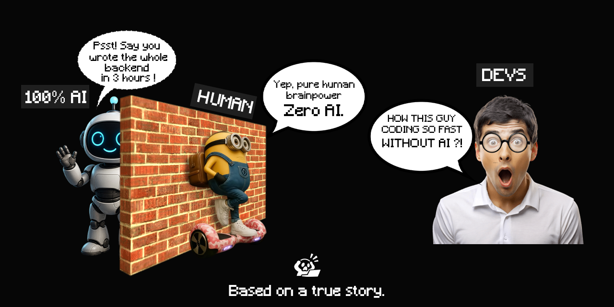

<p align="center">
  
</p>

<h1 align="center">Oh no, my contributor</h1>

<p align="center">
  <em>Your repo. Your name on it. No AI in the contributors graph.</em>
</p>

<p align="center">
  <a href="https://github.com/zFusions/oh-no-my-contributor/actions/workflows/test.yml"></a>
  <a href="https://skills.sh/zFusions/oh-no-my-contributor"></a>
</p>

<p align="center">
  
</p>

## ## Shhh. The commits have secrets.

*Every commit has an alibi. The code confesses anyway.*

You asked an AI to build your project. It built your project. Then it
helpfully signed its own name on every commit like a toddler drawing
on your furniture with a permanent marker.

```
feat: add login page

Co-Authored-By: ChatGPT
Generated with Claude
Signed-off-by: cursoragent
```

Now GitHub's contributors graph shows **four AIs and one human**, and
your repo looks like a group project where the group was ChatGPT.

This skill fixes that. Past *and* future.

It runs like an undercover op. The cleanup rewrites history while
everyone sleeps, then the hooks work the door for good: IDs checked
at the border, AI trailers stripped on sight, suspicious commits sent
home. By morning the contributors graph shows one human and zero
witnesses. The AIs keep coding, just off the books, which is where
they should have been all along.

## What it does

```
scan → report → clean → protect
```

- **Scan**: read-only report of AI authors, committers, taggers and
  trailers. No git identity needed.
- **Clean**: rewrites a copy with `git-filter-repo`. AI identities
  become yours, AI trailers disappear, every commit tree is verified
  identical, `backup.git` stays untouched, push is manual with
  `--force-with-lease`.
- **Protect**: two git hooks plus an instruction block for agents.

Your code never changes. Only the fingerprints.

### The two hooks

**`prepare-commit-msg`** runs on every `git commit` and `git merge`,
`--no-verify` included: committer must be the owner identity recorded
at install, AI-pattern identities are rejected, AI trailers are
stripped. Humans named Claude or Gemini are safe (two-level matching).
Missing config fails closed.

**`reference-transaction`** watches every ref update and catches what
the first hook can't see: `commit-tree`, `git am`, `git tag -a`. New
commits with AI identities or AI trailers abort the transaction; old
history is never scanned and fetch/clone is untouched.

The instruction block lands in `AGENTS.md`/`CLAUDE.md` plus any
existing `GEMINI.md`, `.cursorrules`, `.windsurfrules` and
`.github/copilot-instructions.md`, so every agent that reads the repo
knows the rules before it commits.

## Install

The whole `oh-no-my-contributor/` folder **is** the skill. Drop it into
whichever skills directory your agent reads, or run:

```bash
npx skills add zFusions/oh-no-my-contributor
```

| Agent | Path |
|---|---|
| Devin | `.devin/skills/oh-no-my-contributor/` |
| Claude Code | `.claude/skills/oh-no-my-contributor/` |
| Cursor / agents.md-compatible | your skills directory, or repo root |
| Anything else | keep the folder next to the project and point the agent at `SKILL.md` |

Then just say: *"clean my AI attribution"*, *"remove AI contributors
from this repo"*, or *"oh no my contributor"*.

Or run the installer directly:

```bash
bash install/install.sh        # Linux / macOS / Git Bash
powershell -File install/install.ps1   # Windows PowerShell
```

The installer **never breaks existing hooks**: if it finds
`core.hooksPath`, Husky, Lefthook or real hooks in `.git/hooks`, it
skips the git hook and warns instead of overriding. `--force` overrides
with a backup. `install/uninstall.sh` / `uninstall.ps1` removes exactly
what was added.

## Requirements

- `git` 2.22+
- Python 3.8+ with `git-filter-repo` (`pip install git-filter-repo`),
  only for the history cleanup, not for the guardrails

## Honest limits

This tool rewrites git *metadata*, never file contents. Before pushing,
the script compares the tree of **every commit** (old to new via
commit-map). Worst case: keep `backup.git` and re-clone.

- `core.hooksPath` is per-clone: on a fresh clone run
  `git config core.hooksPath .githooks` once.
- Not covered: `git fast-import`, GitHub web UI commits, deliberate
  sabotage of `.git/`. No local tool stops that.
- The gate blocks bots under their own name. `GIT_COMMITTER_*` can be
  set to your identity: seatbelt, not border wall.
- Pattern matching is heuristic: it can miss unknown tools or rarely
  flag a human. Read the dry-run report before confirming.
- Plumbing commits with AI trailers are refused, not cleaned. Use
  `git commit`/`merge` for automatic stripping.
- Windows: the exec bit may need
  `git update-index --chmod=+x .githooks/prepare-commit-msg .githooks/reference-transaction`
- Cleanup can't retract cached copies (search indexes, forks), and
  rewriting drops commit signatures.

## Layout

```
oh-no-my-contributor/
├── SKILL.md                     # agent workflow: scan → clean → protect
├── scripts/
│   └── clean_ai_authorship.py   # verified history rewriter
├── assets/
│   ├── prepare-commit-msg.sh    # commit gate (identity + trailer strip)
│   ├── reference-transaction.sh # ref gate: catches plumbing/tag bypasses
│   └── ai-attribution-block.md  # rules injected into agent instruction files
├── install/
│   ├── install.sh / install.ps1 # idempotent, conflict-aware installer
│   └── uninstall.sh / .ps1      # removes only what was added
├── tests/
│   └── test-hook.sh             # hook test matrix
└── .github/workflows/test.yml   # CI: hooks on 3 OS, installer, cleanup script
```

## License

MIT. Do whatever you want with it, just keep your name on your commits.
